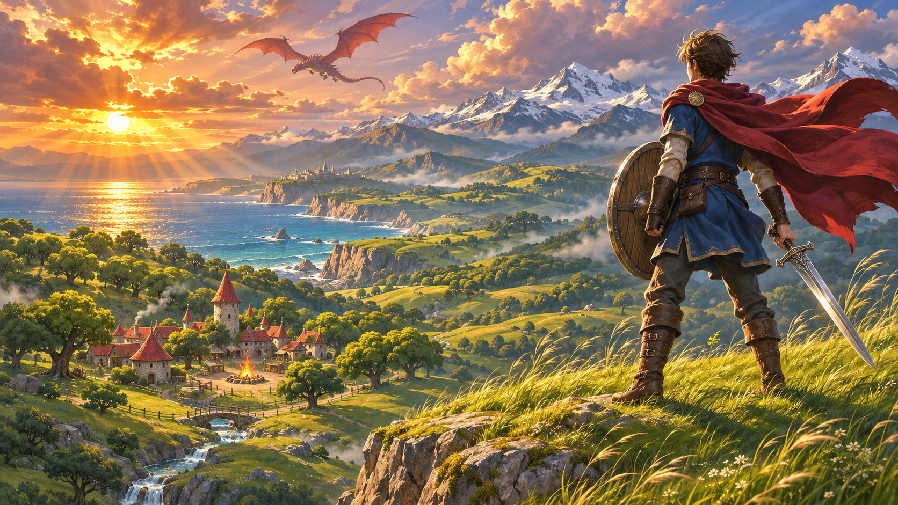
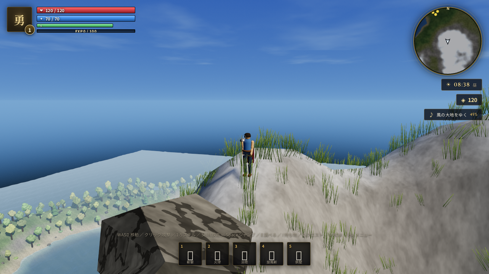
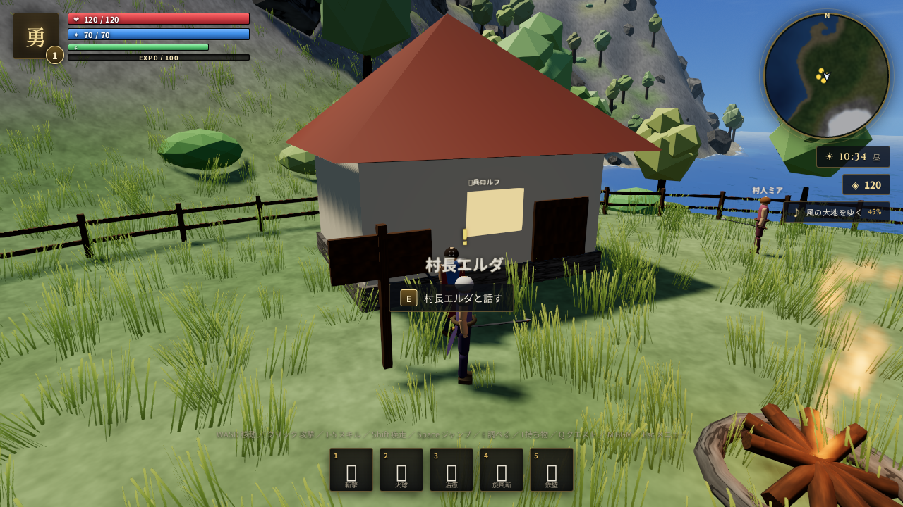
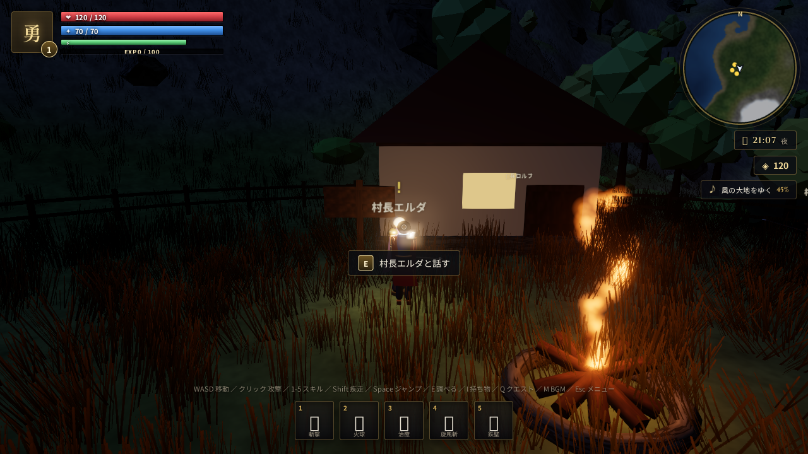

# アヴァロン・クロニクル 〜失われし大地〜

**three.js** だけで作った、手続き生成ワールドの 3D アクション RPG です。
画像・モデル・効果音はすべて実行時にコードで生成しているので、外部アセットは BGM の mp3 だけです。



*▲ タイトル画面のキービジュアル（生成画像）。実際のゲーム内の映像は下のスクリーンショットです。*

## スクリーンショット



*▲ 手続き生成された大地・海・森。時間帯によって光と影が移ろいます。*

| 村（昼） | 焚き火（夜） |
| --- | --- |
|  |  |

---

## 起動方法

ES Modules と WebGL を使っているため、**`file://` で直接開くと動きません**。ローカルサーバーを立ててください。

```bash
# どこかで
cd kougakuin2026
node server.js
#  → http://localhost:8080 をブラウザで開く
```

`node` が無い場合は python でも可:

```bash
python3 -m http.server 8080
```

そのあと `http://localhost:8080/` を開いてください。初回は地形生成のため 2〜5 秒ほどロードします。

> **推奨環境**: Chrome / Edge / Firefox / Safari の最新版（WebGL2 + ES Modules）
> 画面サイズに応じて解像度は自動調整されます。

---

## 操作

| キー | 動作 |
| --- | --- |
| `W A S D` | 移動 |
| マウス | 視点（クリックでポインタロック） |
| 左クリック | 攻撃（3連コンボ） |
| 右クリック | 回避ロール（無敵時間あり） |
| `Shift` | 疾走（スタミナ消費） |
| `Space` | ジャンプ |
| `1` 〜 `5` | スキル（斬撃／火球／治癒／旋風斬／鉄壁） |
| `E` | 話す・調べる |
| `F` | 拾う |
| `I` | 持ち物 |
| `Q` | クエスト |
| `M` | BGM のミュート切替 |
| `[` `]` | BGM の音量 |
| `Esc` | メニュー／ポーズ |

---

## ゲーム内容

- **手続き生成ワールド**（460×460 単位）— シンプレックスノイズによる山岳・森・湖・海岸
- **昼夜サイクル**（1日 = 8分）— 太陽と月が動き、空の色・霧・露出・星がすべて変化
- **村** — 民家・井戸・焚き火・柵・案内板・古代遺跡
- **NPC とクエスト** — 村長エルダ／鍛冶屋ガルド（ショップ）／衛兵ロルフ／村人ミア。全6クエストのチェーン
- **敵 5 種** — スライム／森狼／骸骨戦士／岩のゴーレム／ボス「古代竜ヴァルガ」（火炎ブレスあり）
- **レベルアップ・装備・戦利品** — 武器・防具・回復薬・素材、エリート個体、夜間の強化
- **戦闘** — コンボ、クリティカル、ノックバック、投射物、爆発、パーティクル、カメラシェイク
- **UI** — HP/MP/スタミナ/EXP バー、ミニマップ（地形を実際にサンプリングして描画）、クエストトラッカー、ダメージ表示、ボスバー
- **セーブ／ロード** — ブラウザの localStorage に保存（メニューから手動セーブ）

---

## BGM

`assets/bgm/field-theme.mp3`（**風の大地をゆく — RPG Adventure Field**）をループ再生します。

- 初回のクリック操作で自動再生が始まります（ブラウザの自動再生ポリシー対策）
- WebAudio の `MediaElementSource` 経由で鳴らしているので、`M` キーでミュート、`[` `]` で音量調整ができます
- ファイルが無い／読み込めない場合は、**内蔵の手続き生成アンビエント**に自動で切り替わります
- 別の曲にしたい場合は同じパスに置き換えるか、`js/game.js` の `loadBgm('./assets/bgm/field-theme.mp3')` を書き換えてください

効果音（剣撃・被弾・レベルアップ・足音・焚き火・風など）はすべて WebAudio のオシレータとノイズで合成しています。

---

## ファイル構成

```
index.html            画面・HUD・各UIパネル
css/style.css         ファンタジー風のスタイル（タイトル画面のキービジュアル背景を含む）
server.js             依存ゼロの静的サーバ（Range対応 / 音声シーク用）
vendor/three/         three.js r160（ローカル同梱・オフライン動作可）
assets/bgm/           BGM
assets/images/        タイトル画面のキービジュアル

js/
  main.js             エントリポイント
  game.js             ゲーム全体の統括・ループ・セーブ
  config.js           各種パラメータ
  utils.js            数学・乱数ユーティリティ
  input.js            キーボード／マウス／ポインタロック
  audio.js            効果音の合成 + BGM 再生
  terrain.js          高さ関数・バイオーム・頂点色（世界の基準）
  textures.js         手続き生成テクスチャ（草地・岩・樹皮・水面ノーマル・雲・粒子）
  sky.js              空シェーダ・太陽・月・星・雲・霧・昼夜サイクル
  world.js            地形メッシュ・水面シェーダ・植生・村・衝突判定
  character.js        人型／スライム／狼／ゴーレム／竜のモデルと手続きアニメーション
  player.js           プレイヤーの移動・戦闘・スキル・成長
  enemy.js            敵のAI・ヘルスバー・ドロップ・スポーン管理
  npc.js              NPC とクエストマーカー
  combat.js           近接判定・投射物・パーティクル・エフェクト
  items.js            アイテム定義と持ち物
  quests.js           クエスト定義と進行管理
  camera.js           三人称カメラ（地形衝突・シェイク）
  hud.js              HUD とミニマップ描画
  ui.js               パネル・会話・タイトル・死亡画面
```

---

## 技術的なポイント

- **地形の高さ関数を単一のソースに** — メッシュ生成・キャラクターの接地・草の配置・ミニマップがすべて同じ `heightAt(x, z)` を参照するので、見た目と衝突がズレません。
- **水面** — 3つのゲルストナー波で頂点を動かし、地形の高さを 256×256 の DataTexture として渡して「水深による色と岸の泡」を計算しています。
- **草** — 18,000 本を `InstancedMesh` + カスタムシェーダ（風・プレイヤー周囲のみ表示・焚き火の灯り）で描画。遠くなった株はプレイヤーの周りに再配置されるので、どこまでも草原が続きます。
- **ポストプロセス** — EffectComposer + UnrealBloom + OutputPass(ACES) + SMAA。
- **自動画質調整** — フレームレートを監視して描画解像度を動的に上下させます。

---

## タイトル画面のキービジュアル

`assets/images/title-key-visual.jpg` をタイトル画面の背景に使用しています（`css/style.css` の `--title-art` 変数で差し替え可能）。

- 画像が無い／読み込めない環境では、従来の CSS グラデーション背景に自動でフォールバックします
- ゆっくり拡大するケンバーンズ風アニメーションと、周囲を暗くするグラデーションオーバーレイで、金色のタイトル文字が読みやすいようにしています
- 差し替えるときは同パスに画像を置き換えるだけです（推奨: 16:9・横 1600px 以上）

## ライセンス

- コード: MIT
- three.js: MIT（`vendor/three/LICENSE`）
- BGM: 各自の権利に従ってください
- キービジュアル: このプロジェクト用に生成した画像
